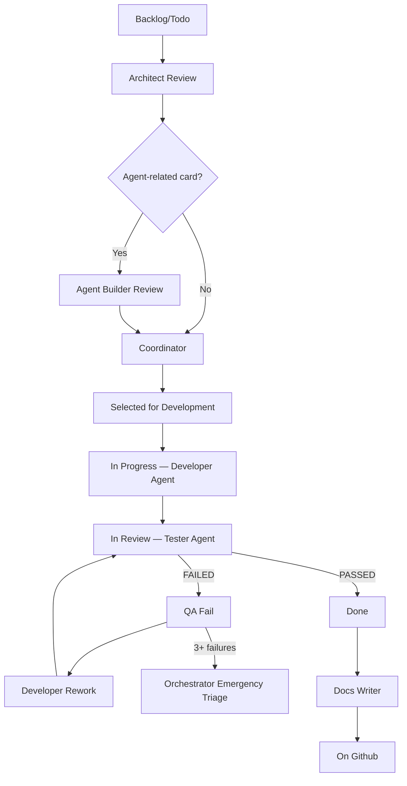

# Linear Pipeline Agents

An automated pipeline that uses Claude Code CLI to drive Linear cards through a full development lifecycle — from architectural review to implementation, testing, QA, and deployment — with specialized AI agents at each stage. Each agent reads the card context from Linear, performs its role (review code, write code, run tests, write docs), posts results as comments, and the pipeline driver advances the card to the next status based on those comments.

## How It Works

The pipeline driver polls your Linear team for cards in actionable states, determines what needs to happen next by reading each card's comments and status, spawns a Claude Code CLI agent with a role-specific prompt, and moves the card forward when the agent posts its results. A separate watcher process provides a live terminal dashboard showing card movements, agent comments, and overall pipeline health.

## Prerequisites

- **Linear account** with an API key (Settings > API > Personal API Keys)
- **Claude Code CLI** — install from [claude.ai/claude-code](https://claude.ai/claude-code)
- **Node.js** (v18+)
- **jq** — `brew install jq` on macOS
- **curl**

## Quick Start

```bash
git clone https://github.com/your-org/linear-pipeline-agents.git
cd linear-pipeline-agents
bash setup.sh
bash start.sh
```

`setup.sh` walks you through connecting to Linear, selecting your team, verifying workflow states, and configuring your project. `start.sh` launches both the driver and watcher.

## Pipeline Workflow



## Agent Roles

**Architect** — Reviews every card before development begins. Reads the project source code, analyzes the card's requirements against the existing codebase, and posts an "Architect Review" comment with a verdict, code analysis (specific files and lines), technical recommendations, risk assessment, and acceptance criteria review. This ensures no card enters development without understanding its impact on the system.

**Agent Builder** — A prompt engineering specialist that reviews cards tagged as agent-related (configured via `AGENT_BUILDER_CARDS`). Posts an "Agent Builder Assessment" covering prompt quality analysis, tool binding recommendations, model selection guidance, system prompt templates, and integration notes for how the agent connects to the broader system.

**Coordinator** — Reads the Architect Review (and Agent Builder Assessment if present), consolidates all recommendations into the card description so it becomes the single source of truth, and posts a "Coordinator Review" comment. After the Coordinator finishes, the card is ready for development.

**Developer** — Picks up cards in "Selected for Development", reads the enriched card description, implements the changes in the configured project directory on the configured git branch, commits locally (does not push), and posts a "Developer Summary" comment describing what was implemented. For rework cycles after QA failure, reads the tester's failure comments and posts a "Developer Summary (Rework)" comment.

**Tester** — Validates developer work by fetching the Developer Summary, checking the implementation against acceptance criteria, running the configured test and lint commands, and posting either "Tester Results — PASSED" or "Tester Results — FAILED" with specific failure details. The pass/fail result drives whether the card advances to Done or falls back to QA Fail.

**Docs Writer** — Reviews completed cards for documentation needs and posts a "Docs Writer" comment. After the docs step, the card moves to "Needs Documentation" and eventually "On Github" when the driver pushes commits to the remote.

**Orchestrator** — Emergency triage agent that activates when a card fails QA 3 or more times. Reads all tester failure comments, makes the minimal direct fix (TypeScript errors, formatting, missing imports), runs tests, commits, and posts a rework summary. If the fix requires significant refactoring, it posts an explanation and creates a new scoped card instead.

## Configuration Reference

| Variable | Description | Default |
|----------|-------------|---------|
| `LINEAR_API_KEY` | Your Linear personal API key | (required) |
| `LINEAR_TEAM_ID` | The Linear team ID to poll | (required) |
| `POLL_INTERVAL` | Seconds between each poll cycle | `30` |
| `MAX_AGENTS` | Maximum concurrent Claude agents | `5` |
| `MAX_RETRIES` | Max spawn attempts per card+role | `3` |
| `MIN_CARD` | Minimum card number to process | `1` |
| `MAX_CARD` | Maximum card number to process | `9999` |
| `GIT_BRANCH` | Git branch for development work | `main` |
| `PROJECT_DIR` | Absolute path to your project | (required) |
| `TEST_CMD` | Command the tester runs for validation | `npx tsc --noEmit` |
| `LINT_CMD` | Command the tester runs for linting | `npx prettier --check 'src/**/*.ts'` |
| `AGENT_BUILDER_CARDS` | Comma-separated card numbers needing agent-builder review | (empty) |

## Anti-Loop Logic

The pipeline's most critical piece of engineering is its anti-loop logic for the QA cycle. This was debugged over many iterations and should not be modified without thorough understanding.

**The problem:** When a card fails QA, the tester posts a "Tester Results — FAILED" comment. The developer reworks the card and posts a "Developer Summary (Rework)" comment. On the next poll, the card is back in "In Review" and the tester runs again. But the old "FAILED" comment is still there. Early versions checked `has('Tester Results — FAILED')` which returned `true` forever once a card failed, causing infinite bouncing between In Review and QA Fail.

**The fix:** Instead of checking for the presence of comments, the pipeline tracks the **index** of the last tester comment (`lastTesterIdx`) and the last developer comment (`lastDevAnyIdx`). The variable `testerIsNew` is only `true` when `lastTesterIdx > lastDevAnyIdx` — meaning the tester's result came AFTER the developer's most recent summary. This ensures:

1. Old tester FAIL comments do not re-trigger QA Fail status after a rework
2. Old tester PASS comments do not prematurely advance a card after new development
3. The developer rework is only recognized as "new" if `lastDevReworkIdx > lastTesterIdx`

This index-based ordering is the only reliable way to determine the current state of a card in a comment-driven pipeline where comments are append-only and never deleted.

## Customizing Agent Prompts

All agent prompts are defined inline in `scripts/pipeline-driver.sh` inside the `spawn_agent()` function. Each role has a `case` branch that constructs a prompt string. The following variables are available in prompts:

- `$ident` — Card identifier (e.g., "PROJ-42")
- `$title` — Card title
- `$desc` — Card description (truncated to 3000 chars)
- `$issue_id` — Linear issue UUID
- `$API_KEY` — Linear API key for posting comments
- `$PROJECT_DIR` — Project directory path
- `$GIT_BRANCH` — Active git branch
- `$TEST_CMD` / `$LINT_CMD` — Test and lint commands

To modify a prompt, find the relevant `case` branch in `spawn_agent()` and edit the `prompt=` string. The agent receives this as a single `-p` argument to `claude`.

## Adding New Agent Roles

1. Add a new `case` branch in `spawn_agent()` with a unique role name and prompt
2. Add a trigger condition in the main Node.js action-parsing block (the large inline script in the polling loop) that emits a `spawn|your_role|...` action line based on card status and comment state
3. Define what comment marker the new agent posts (e.g., "Security Review") and add corresponding `has()` checks
4. Update the watcher's `agent_name()` and `agent_color()` functions in `scripts/pipeline-watch.sh` to recognize and style the new agent's comments

## Troubleshooting

**Stale PID files** — If agents appear stuck, delete their PID files:
```bash
rm /tmp/linear-pipeline-state/agents/*.pid
```

**Retry exhaustion** — If a card+role has hit MAX_RETRIES and you want to retry:
```bash
rm /tmp/linear-pipeline-state/retries/*.count
```

**Missing workflow states** — If the driver fails on startup with missing states:
```bash
bash setup.sh
```

**Driver already running** — If you get a "Driver already running" message but no driver is active:
```bash
rm /tmp/linear-pipeline-state/driver.lock
```

**No Claude CLI** — Install from [claude.ai/claude-code](https://claude.ai/claude-code). The pipeline requires the `claude` command to be available in your PATH.

**Cards not being picked up** — Check that your card numbers fall within `MIN_CARD` and `MAX_CARD`, and that the cards are in one of the watched statuses (Backlog, Todo, Selected for Development, In Progress, In Review, QA Fail, Done).

## License

MIT
